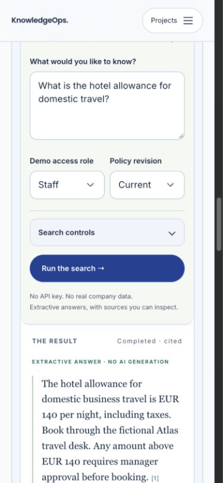

# KnowledgeOps

Permission-aware document retrieval with exact passage citations. Access is filtered before ranking; answers are extracted from permitted passages, and missing or conflicting evidence produces an abstention.

Version **0.2.1**. The default application is a self-hostable deterministic demonstration with synthetic data. It executes real application code, makes no paid model calls and changes no customer systems. [Try the public demo](https://portfolio.gappazappa.in/projects/knowledgeops).

## Run locally

Install [Docker Desktop or Docker Engine with the Compose plugin](https://docs.docker.com/get-started/get-docker/) and Git, then start the Docker engine. Also install Python 3.12+ for the configuration helper. Check that `docker info` and `docker compose version` succeed. Commands use a POSIX shell (macOS, Linux or WSL2 on Windows). If you use a named Docker context, pass `docker --context NAME compose ...` consistently. After cloning, run the remaining commands from the repository root.

```sh
git clone https://github.com/prasanthp01/knowledgeops.git
cd knowledgeops
python3 scripts/configure_compose.py
docker compose --env-file .env.compose up --build -d --wait
```

Open **http://127.0.0.1:8045/projects/knowledgeops**. The default stack publishes only a loopback port. Generated credentials are ignored by Git; keep them private. Use `--env-file .env.compose` on every Compose command. Keep that file with its database volume; changing only the passwords will not update an existing database. The helper refuses to overwrite an existing configuration file. See [troubleshooting](docs/TROUBLESHOOTING.md).



### Check and restart

```sh
docker compose --env-file .env.compose ps
curl --fail --silent --show-error http://127.0.0.1:8045/api/projects/knowledgeops/ready
docker compose --env-file .env.compose stop
docker compose --env-file .env.compose up -d --wait
```

Readiness must return HTTP 200. For startup failures, inspect `docker compose --env-file .env.compose logs --tail=80 api worker`. Reload the browser after restarting. Use `stop` to pause; `down` removes this Compose project's containers and network but retains its named volume. Do not use `down -v` when you want to keep your data.

For an occupied port or a second checkout, use a separate Compose project and matching port/origin:

```sh
KO_HOST_PORT=8046 KO_PUBLIC_ORIGIN=http://127.0.0.1:8046 docker compose --env-file .env.compose -p knowledgeops-second up --build -d --wait
```

Open `http://127.0.0.1:8046/projects/knowledgeops`. Keep the same environment overrides and `-p knowledgeops-second` on subsequent Compose commands; otherwise you will address the default instance. [Compose project names](https://docs.docker.com/compose/how-tos/project-name/) isolate containers and volumes between checkouts.

## Try it

Ask **What is the hotel allowance for domestic travel?** Staff/current returns the fictional EUR 140 passage with its exact document revision. Historical preview returns EUR 110. Conflicting revisions abstain. Staff cannot retrieve the restricted treasury passage; Finance can.

Change inputs, run again, inspect chronological server events, switch to the technical view and compare results. Recorded results are labelled separately from a new execution.

## How it works

FastAPI validates questions, roles and retrieval settings. PostgreSQL stores immutable document versions, inherited chunk permissions, jobs and audit events. A separate leased worker performs permission-filtered BM25 or keyword retrieval and validates citations. The public corpus has 27 original synthetic document versions; no customer documents are bundled.

- [Architecture and tradeoffs](architecture.md)
- [API, request formats and examples](docs/API.md)
- [Operations, backup and recovery](operations/runbook.md)
- [Security boundaries and reporting](SECURITY.md)

## Scope and production deployment

The role selector demonstrates permissions; it is not enterprise identity management. Public upload, OCR, vector embeddings and live model summaries are not enabled. The private content adapter remains disabled by default. Optional Contracts v1 synthetic peer calls never send document passages or enable paid inference.

For an internet-facing deployment, follow [deployment requirements](docs/DEPLOYMENT_GUIDE.md): configured HTTPS origin, secure cookies, narrow ingress, isolated storage, resource limits, tested backups and monitored health. The default local command is not an internet-facing deployment. Production readiness applies to the documented synthetic scope; live inference and enterprise workloads require separate validation.

## Verify and contribute

Install [uv](https://docs.astral.sh/uv/getting-started/installation/) for source verification. The following commands select Python 3.12 and install the locked development dependencies. Run them from the repository root.

```sh
uv sync --frozen --python 3.12
uv run python scripts/configure_tests.py
docker compose --env-file .env.test -f compose.test.yaml up -d --wait
uv run ruff check knowledgeops tests scripts migrations
uv run ruff format --check knowledgeops tests scripts migrations
uv run mypy knowledgeops
uv run --env-file .env.test pytest -q
docker compose --env-file .env.test -f compose.test.yaml stop
```

The test stack has a separate Compose project and volume, binds PostgreSQL only to `127.0.0.1:55446`, and generates its own owner/runtime credentials in ignored `.env.test`. Tests migrate and seed `knowledgeops_test` and refuse ordinary application databases. Keep `.env.test` with its volume for repeat runs; the helper preserves existing configuration. To choose a different port on first setup, use `uv run python scripts/configure_tests.py --port 55447`. Never point tests, load tools or recovery drills at a live deployment. The [release report](docs/RELEASE_READINESS.md) records current test results and remaining limits. Hosted CI repeats the relevant checks on pushes and pull requests. See [CONTRIBUTING.md](CONTRIBUTING.md) for the test environment and review process.

## Performance and cost

Use `uv run python scripts/benchmark_http.py` in an isolated environment and record the revision, hardware, concurrency and duration. Synthetic provider costs and modeled latency are not invoices or live-provider measurements. Keyless runs have zero external model spend; hosting and CPU costs remain separate. No commercial-scale capacity or independent penetration-test claim is made.

## License

MIT for the original implementation. Bundled dependencies and assets retain their own licenses; see [third-party notices](NOTICE.md). No personal CV, portrait, deployment credentials or private customer data is included.
