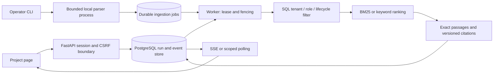

# Architecture

Source documents retain a stable ID, immutable version, metadata checksum, collection, group ACL, classification, created/updated time, source path, validity and retention deadlines. Chunks inherit ACL via their versioned document foreign key, with stable section/page/chunk references. SHA-256 covers canonical document metadata and text; it is not a publisher signature. Duplicate versions with matching checksums are no-ops; differing content under the same version is rejected. New current versions move older current versions to historical status. Conflicting policy fixtures use a shared policy key and explicit scenario mode.

The default `demo` tenant is hardcoded in the public worker and retrieval path. Query SQL filters tenant, groups, collection, active lifecycle and deadlines before loading passages or computing BM25 document frequencies. Historical and conflict toggles operate only on permitted fictional data. A coarse ingestion revision invalidates cached demo runs after supported document changes; read-time checks also reject citations whose ACL or lifecycle no longer permits access.

Every run belongs to an opaque high-entropy HttpOnly session token stored hashed in PostgreSQL. Separate CSRF secrets and exact Origin validation protect mutations. Guessing a run UUID grants nothing. Admission uses a transaction-level advisory lock to enforce global/per-session concurrency, rate buckets and idempotency. Public sessions expire in one hour; runs in 30 minutes. A worker clears expired state and stale rate buckets every 15 seconds; read checks apply even during worker outage.

Run insertion and queueing are one transaction. Workers claim via `FOR UPDATE SKIP LOCKED`, increase a monotonic claim epoch and set a lease. Each event and final commit rechecks the claim. Lease expiry allows retry; stale or cancelled workers cannot commit. Work is bounded to a small corpus, maximum five citations and three attempts. Metadata events describe observable stages, never model chain-of-thought.

Ingestion jobs are separate durable rows and run in the same bounded worker process. Parser subprocesses reject unsupported, encrypted, active-content, oversized and non-extractable documents. Linux address-space and CPU limits complement byte/page/time ceilings. Injection detection is heuristic; security ultimately relies on treating text as data, output encoding, permission checks and disabling arbitrary tools, not on the detector recognizing every attack.

The optional private API binds role/tenant to trusted server configuration and a bearer token. Current content inference is disabled because the companion AgentOps contract is incompatible. A proposal-only adapter has local budget reservations, bounded HTTPS response reading, no redirect/direct-provider fallback, exact-quote validation and post-call revocation checks. See ADR 004.

PostgreSQL query patterns follow the primary [SKIP LOCKED documentation](https://www.postgresql.org/docs/18/sql-select.html) and [Psycopg pool lifecycle](https://www.psycopg.org/psycopg3/docs/advanced/pool.html). Production connection capacity must include API and worker pools separately.

